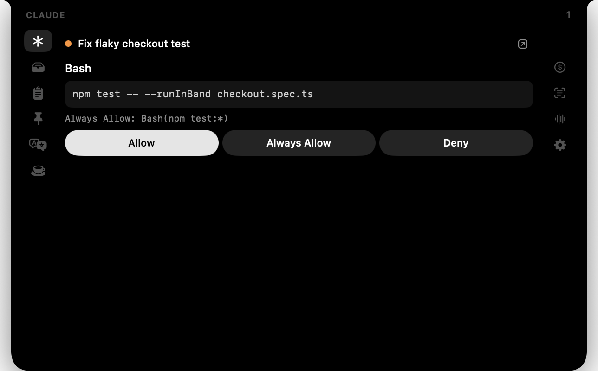
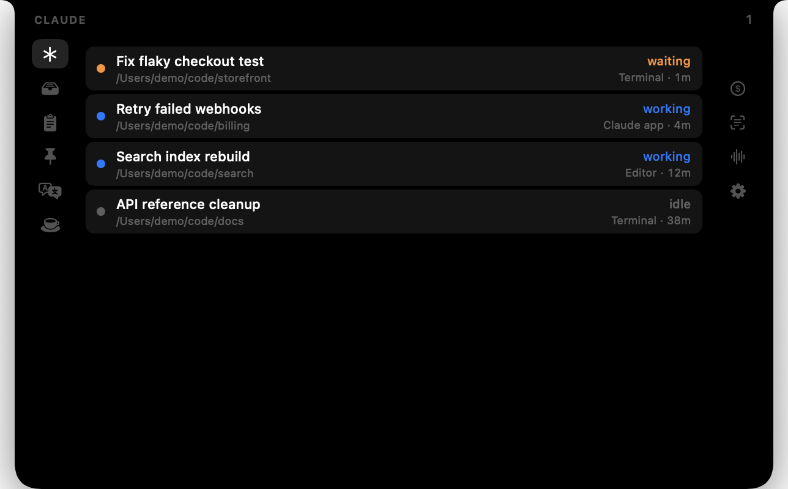
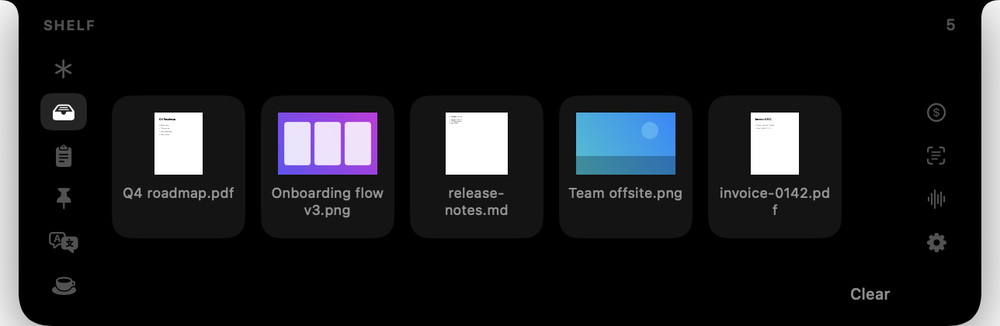
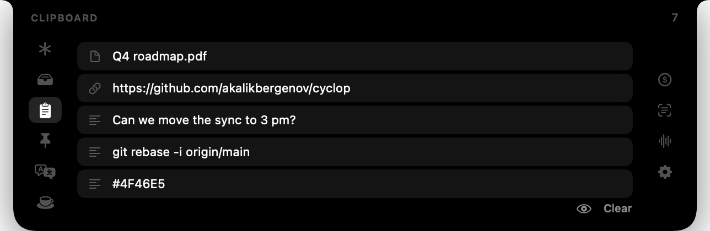
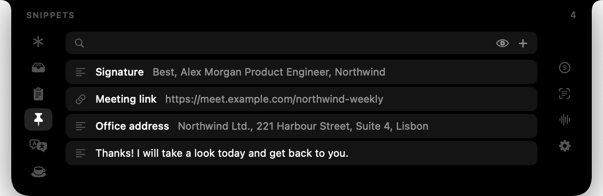
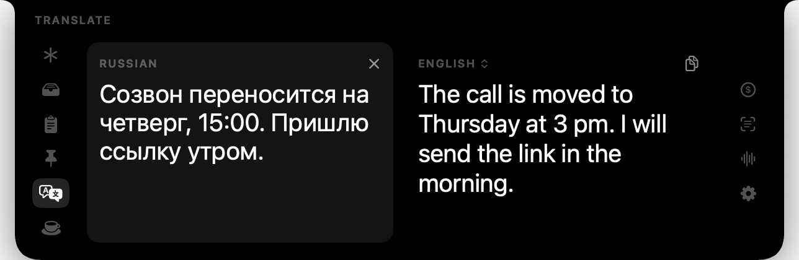
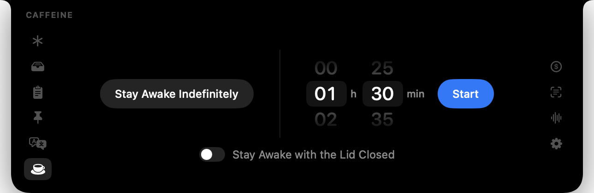
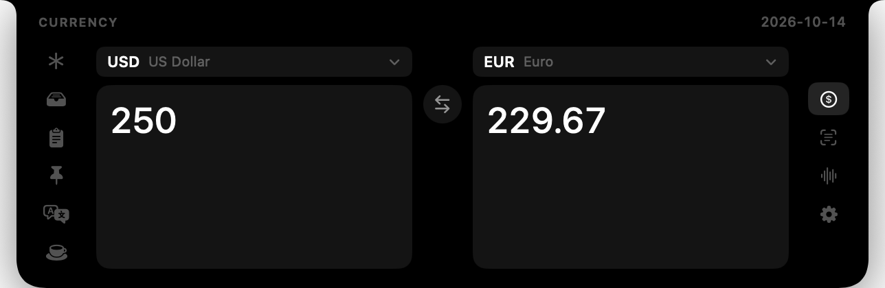
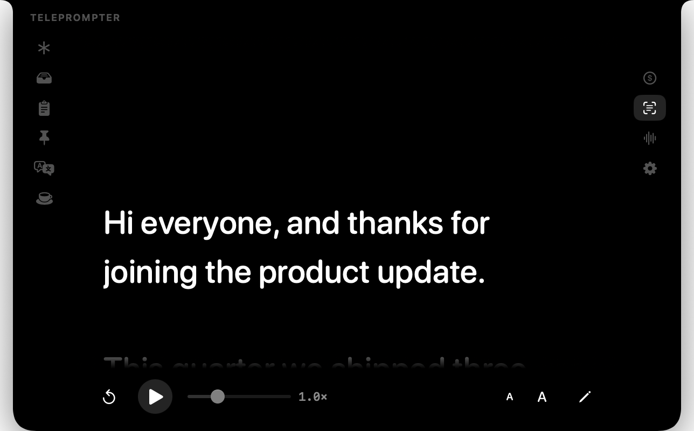
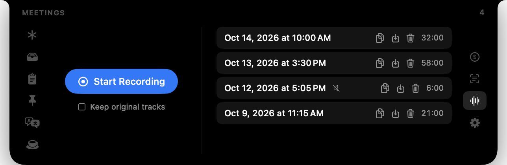

# Cyclop

*English · [Русский](README.ru.md)*

The MacBook notch as a working tool. Cyclop is invisible at rest; bring the
pointer to the notch and it unfolds into a panel of tabs: your Claude Code
sessions and their requests, a shelf for files, clipboard history, snippets,
offline translation, a keep-awake timer, currency, a teleprompter and meeting
transcripts. A native SwiftUI/AppKit app for macOS 15 and newer.

[](https://github.com/akalikbergenov/cyclop/actions/workflows/build.yml)
[](https://buymeacoffee.com/akalikbergenov)



This is a personal fork of [akalikbergenov/cyclop](https://github.com/akalikbergenov/cyclop),
which no longer merges upstream ([ADR 0001](docs/adr/0001-fork-diverges-from-upstream.md)).
The badges, the download link and the clone command below still point at upstream.

## A tour of the panel

The panel opens when the pointer reaches the notch and folds when it leaves.
Tabs sit on two rails, left and right of the content; a tab switches when the
pointer rests on its icon, so passing over one switches nothing. During a file
drag the panel opens by itself on the shelf. On a Mac without a notch the panel
draws one at the top centre of the screen.

Hold an icon (or press it hard on a Force Touch trackpad) to lift it, then drag
it along its rail or onto the other one. **Settings → Cyclop → Show in Panel**
switches any tab off: its icon leaves the rail and its background work stops. The
menu bar icon opens the panel, covers the contents of Clipboard, Snippets and
Claude (**Hide Contents**) and quits.

### Claude



The Claude Code sessions running on this Mac, waiting ones first: working,
waiting or idle, where each runs (the Claude app, an editor, a terminal) and for
how long. A click opens the session where it runs. After **Connect to Claude** in
Settings, a request (a permission, a question, a plan) slides the panel out (unless
**Open Panel for Requests** is off) and is answered right there, as in the picture at the top; Claude keeps asking in its
own window too, and the first answer counts. An approved plan can go on in a new
session with a cleared or compacted context ([ADR 0005](docs/adr/0005-an-approved-plan-can-go-on-in-a-new-session.md)).

### Shelf



Drop files on the notch and they wait here; drag a card out and the file goes
wherever it is dropped. A click selects a card and copies it, ⌘-click selects
several to drag together, a double-click opens the file, and the right-click menu
has Show in Finder and Remove from Shelf. While the Clipboard tab and **Save
Clipboard Screenshots** in Settings are on (both are by default), a screenshot copied to the clipboard is saved as a file into `~/Pictures/Cyclop`
and lands here too; one copied on an iPhone arrives through Universal Clipboard
(the same Apple ID, Handoff on, the devices nearby).

### Clipboard



The last 40 copies, text and files. A click puts an entry back on the clipboard
and moves it to the top. Copies that password managers mark as concealed never
enter the list, and the list lives in memory only: it is empty after a relaunch.

### Snippets



What you are tired of retyping: an address, a signature, a link. **+** adds one,
a click copies it, a double-click edits it, the arrows on hover reorder. The list
is `~/Library/Application Support/Cyclop/snippets.json` and can be edited there
too.

### Translate



Type on the left and the translation appears on the right, offline, through the
macOS Translation framework. Russian goes to English or Polish, and those go to
Russian: the direction follows the script you type in, and a click on the column
title switches between English and Polish. macOS does not preinstall language
packs; the tab says so and opens the settings screen that downloads them.

### Caffeine



Keeps the Mac from sleeping: indefinitely, or for the time on the wheel. Only
the system stays awake; the screen still dims and locks on schedule. **Stay
Awake with the Lid Closed** keeps it working with the lid shut, so agents run on
while you are away. A session ends when you stop it, when the tab is switched
off, or when Cyclop quits.

### Currency



An amount on one side, the other currency on the other; type into either. Rates
come from the public [exchange-api](https://github.com/fawazahmed0/exchange-api)
table, refreshed every hour and whenever the tab opens, and only while the tab is
on.

### Teleprompter



A script that scrolls under the camera at the speed you set, so your eyes stay
by the lens while you read. While the text moves the panel holds itself open,
because reading a script means not touching the trackpad.

### Meetings



**Start Recording** records a call on two tracks, the microphone and everything
the Mac plays. After **Stop** the meeting is transcribed on this Mac: your lines
are *Me*, the other side is *Speaker*, lettered when several voices can be told
apart, and the language is detected for each stretch of the other side's speech. The audio is then kept compressed as
`audio.m4a` (**Keep original tracks** keeps the two raw tracks beside it), and
**Export** puts the transcript and the audio into Downloads. The speech models
are downloaded once, by a button.

## Permissions

Nothing is asked at launch; each request comes with the first press of the
button that needs it.

- **Microphone and system audio**: the first **Start Recording** in Meetings.
- **Control of Terminal or iTerm**: the first **Open in Claude** on a terminal
  session, or a plan handed off to a new terminal session, so the session's own
  tab can be selected or a `claude` command typed. Refused, **Open in Claude** only
  brings the terminal forward, and a hand-off stops with *Automation is not allowed*
  and a **Copy Command** button.
- **Downloads**: the first **Export** of a meeting.
- **Files in protected folders**: a file put on the shelf from Downloads,
  Documents or the Desktop may make macOS ask when the shelf opens. Refused, the
  card stays without a preview.

The pointer is read through `NSEvent.mouseLocation` and the clipboard through the
public `NSPasteboard`; neither needs a permission. **Connect to Claude** adds one
entry to Claude Code's settings file and keeps a copy of the file first;
**Disconnect from Claude** removes it ([ADR 0004](docs/adr/0004-claude-requests-are-answered-through-a-hook.md)).

## What stays on this Mac

Cyclop opens two kinds of outgoing connection, both described in
[SECURITY.md](SECURITY.md): the currency rates, and the speech models of Meetings,
downloaded from Hugging Face when you press the button. Translation and
transcription run on the Mac. The Claude tab reads Claude Code's session files and
answers requests through a local socket; only when you approve a plan into a new
session does Cyclop start `claude` itself, which spends your Claude tokens like
any session.

What Cyclop keeps is in `~/Library/Application Support/Cyclop/` (`config.json`,
`snippets.json`, `teleprompter.txt`, the `Meetings/` folder, the last five copies
of Claude's settings file in `claude-settings-backups/`), the speech models in
`~/Library/Application Support/FluidAudio/`, in its
`com.cyclop.app` preferences (the shelf's list, a few choices) and in
`~/Pictures/Cyclop` (clipboard screenshots, never deleted automatically). The shelf
references files rather than copying them.

## Install

**[Download the latest release](https://github.com/akalikbergenov/cyclop/releases/latest)**,
open the `.dmg` and drag Cyclop into Applications. Releases are signed with a
Developer ID and notarised. The link is upstream's: this fork has no releases of
its own, so its own tabs come from a build from source.

### Build from source

You need macOS 15 or newer, a Swift 6 toolchain (Command Line Tools are enough)
and CMake for the Meetings echo canceller (`brew install cmake`;
`CYCLOP_SKIP_LOCALVQE=1` builds without it).

```bash
git clone https://github.com/akalikbergenov/cyclop.git
cd cyclop
./Scripts/bundle.sh          # swift build + assemble build/Cyclop.app + sign
open build/Cyclop.app
```

A build from source is ad-hoc signed and not notarised, so on another Mac the
first launch goes through **System Settings → Privacy & Security → Open Anyway**.
`./Scripts/test.sh` runs the unit tests and `./Scripts/check-strings.py` checks
that every on-screen string is translated.

### Images and releases

`./Scripts/dmg.sh` puts `build/Cyclop-<version>.dmg` next to the app.
`./Scripts/release.sh` checks the tree, tags `v<version>` and pushes the tag; the
release workflow then builds the signed image and publishes the GitHub release.
The script refuses to run without `gh`, without hand-written notes in
`docs/releases/<version>.md`, on a dirty tree, on unpushed commits, when the tag
exists or when CI on the commit is not green. The version lives in one place, `Scripts/version`.

## How it works

Why the window is shaped the way it is, why the pointer is polled on a timer,
what sitting idle costs: [docs/architecture.md](docs/architecture.md). The words
used for the parts of the panel are in [CONTEXT.md](CONTEXT.md), and the
decisions in [docs/adr/](docs/adr/).

The pictures in this README come from a demo build with invented data
(`./Scripts/bundle.sh demo`) and are re-taken by
`.claude/skills/update-readme/shoot.sh`.

## Contributing

The rules live in [CONTRIBUTING.md](CONTRIBUTING.md). The main one: the app keeps
to the permissions and connections [SECURITY.md](SECURITY.md) lists, and a change
that adds one is a separate conversation. Vulnerabilities go through the private
channel described in SECURITY.md.

## Thanks

Cyclop was created by [akalikbergenov](https://github.com/akalikbergenov) and is
free: no subscriptions, no ads, no data collection. If it turned out useful and
you feel like supporting it:

**[☕ Buy Me a Coffee](https://buymeacoffee.com/akalikbergenov)**

Special thanks to everyone who showed up in the first days and made the app
better: [@DontTrustMexD](https://github.com/DontTrustMexD),
[@a58becde](https://github.com/a58becde),
[@ispy4you](https://github.com/ispy4you),
[@iFuzYs](https://github.com/iFuzYs),
[@zhd-dm](https://github.com/zhd-dm),
[@komekovars](https://github.com/komekovars),
[@superkai-sdk1](https://github.com/superkai-sdk1),
[@Ariet2003](https://github.com/Ariet2003).

## Licence

[MIT](LICENSE)
